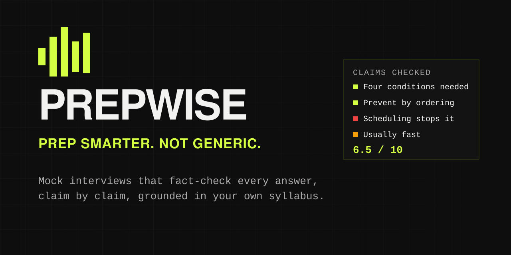
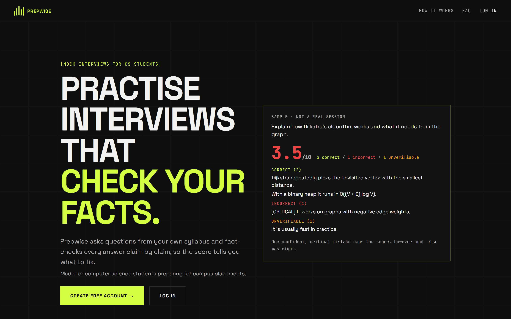
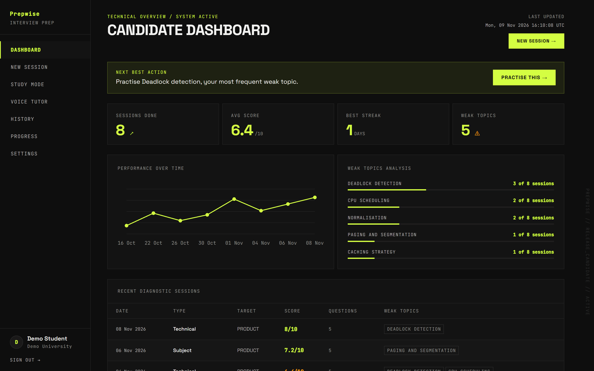
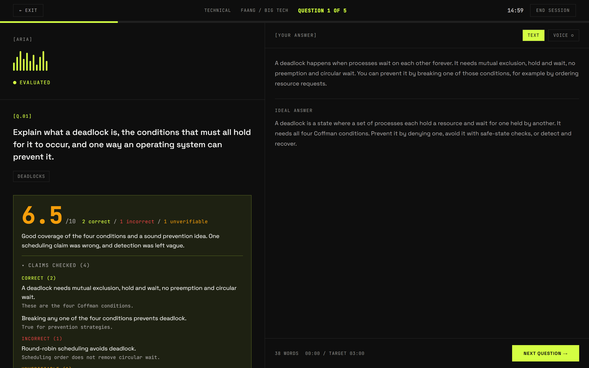
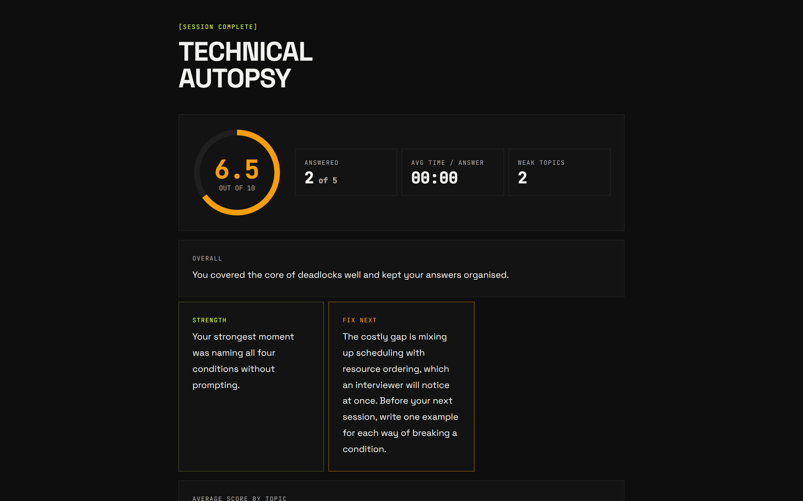
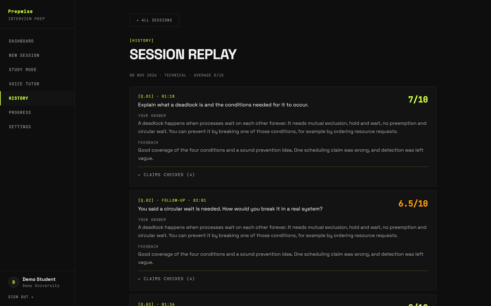
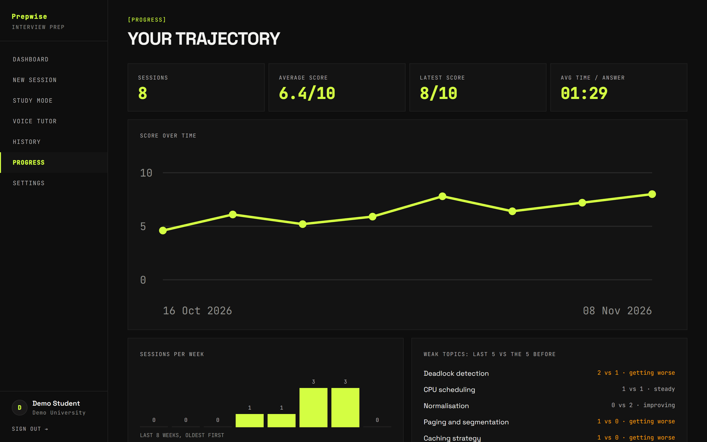
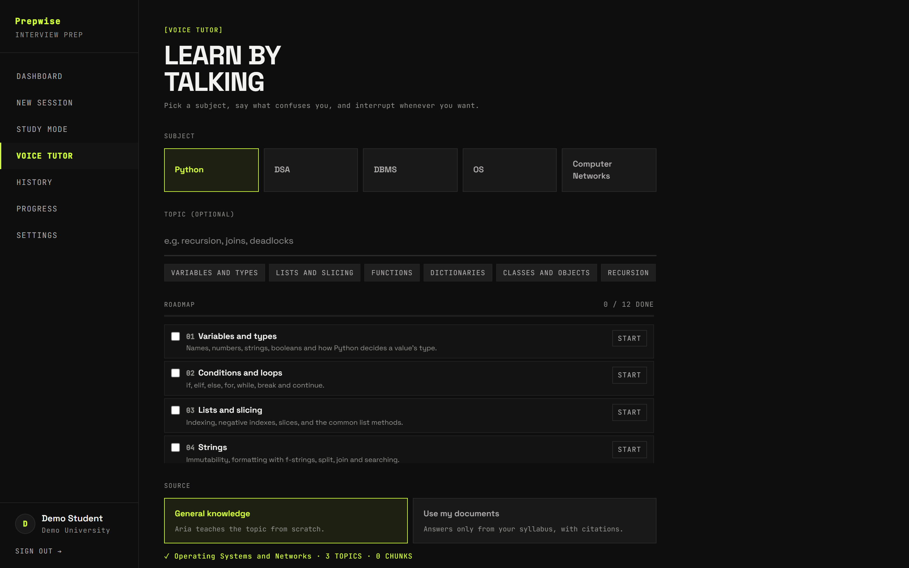
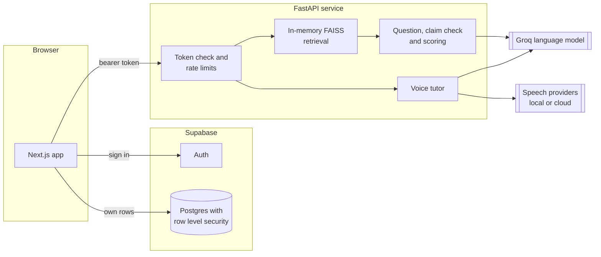

<div align="center">



<br />

[](LICENSE)
[](https://github.com/SuyashVJain/prepwise/actions/workflows/ci.yml)
[](https://github.com/SuyashVJain/prepwise/commits/main)
[](https://nextjs.org)
[](https://fastapi.tiangolo.com)
[](https://www.python.org)
[](https://supabase.com)

</div>

Prepwise is a mock-interview coach for computer science students. It generates questions from your own syllabus, then the language model checks every claim in your answer, so the score tells you what was right, what was wrong and what was too vague to count. It was built as a semester project and runs as a Next.js web app on top of a FastAPI service.

## Why it is different

- **Every answer is fact-checked.** Each claim in your answer is marked correct, incorrect or unverifiable before it is scored, and you can open the list after every question. A confident, critical mistake caps the score in code, however fluent the rest sounds. The check is made by the language model using its own knowledge; the syllabus is context for question generation, not the source of truth for correctness, and scores are a guide rather than a verdict.
- **Adaptive follow-ups.** If an answer is weak or has a doubtful claim, the next question can probe that exact point once, then move on.
- **Questions from your syllabus.** Upload a syllabus PDF or choose topics, and questions are generated using retrieved sections of that material as context instead of a fixed question bank. When you choose topics instead of uploading a PDF, the context is a short description of each topic rather than your own text.
- **A voice tutor.** Learn a subject by talking to Aria. Interrupt at any time, ask for a re-explanation, switch to Hinglish, and get notes and flashcards at the end.
- **Replay and progress.** Open any past session to see each question, answer, score and claim. Track scores, pace and weak topics over time.

## Screenshots

| | |
|---|---|
|  |  |
| **Landing page** | **Dashboard** |
|  |  |
| **Interview with checked claims** | **Debrief** |
|  |  |
| **Session replay** | **Progress** |

<details>
<summary>Voice tutor</summary>



</details>

The screenshots use made-up demo data. See [`scripts/screenshots`](scripts/screenshots) to regenerate them.

## Features

**Interview**
- Four interview types (technical, HR, system design, subject) and four company styles
- Questions generated from your syllabus, one at a time, with retrieved sections as context
- Type or speak your answers; a timer shows your pace against a soft target
- Adaptive follow-up questions, at most one per question and a third of a session
- Ending early saves only what you answered; a session in progress survives a page refresh

**Feedback**
- Claim-by-claim check with confidence and critical errors, shown as a collapsible list
- Score with fixed bands (8 to 9 for correct and complete, under 4 for a wrong core idea) and caps in code
- Debrief with score ring, strengths and fix-next cards, a topic chart, practice links and PDF export

**Study**
- Upload several documents and chat across them with source citations
- Generate multiple-choice quizzes from your material

**Voice tutor**
- Speech to text runs in the cloud (Groq Whisper). The spoken reply uses the Groq voice for English and falls back to your browser's own voice, which also reads Hinglish, with a "Tap to enable voice" button when the browser blocks autoplay. An optional local Kokoro voice exists for machines with spare memory and is off by default
- Mock interview answers can be typed or spoken. Spoken answers are recorded in the browser and transcribed on the server (`POST /interview/transcribe`), so they work in any browser that can record audio
- Doubt mode, Hinglish mode, session notes and flashcards, subject roadmaps, visual walkthroughs, video suggestions and a Python code-along
- Hand-off from the tutor to a mock interview on the same topic

**Progress and history**
- Filter and sort past sessions, replay any one, copy a summary
- Score trend, sessions per week and weak topic trend
- Settings with saved session defaults and a delete-my-data action

## Architecture



The web app signs in through Supabase and stores a student's sessions there under row level security. The API is stateless: it verifies the token, retrieves syllabus chunks, calls the language model and returns results. The full picture, including the answer-scoring pipeline and the reasons behind the main decisions, is in [docs/ARCHITECTURE.md](docs/ARCHITECTURE.md).

## Tech stack

| Layer | Technology |
|---|---|
| Frontend | Next.js 16, React, TypeScript, Tailwind CSS v4 |
| Backend | FastAPI, Python 3.11 |
| Language model | Groq, default `openai/gpt-oss-120b` |
| Retrieval | fastembed (ONNX) `all-MiniLM-L6-v2`, FAISS (in memory) |
| Documents | PyMuPDF, python-docx |
| Auth and data | Supabase Postgres with row level security |
| Voice | Groq Whisper (speech to text), Groq speech (English), the browser voice (fallback and Hinglish) |
| Deploy | Vercel (frontend), Render (backend) |

## Quick start

### Prerequisites

- Node.js 20 or newer and npm
- Python 3.11
- A [Supabase](https://supabase.com) project (free tier is fine)
- A [Groq](https://console.groq.com) API key

### 1. Clone

```bash
git clone https://github.com/SuyashVJain/prepwise.git
cd prepwise
```

### 2. Database

In the Supabase SQL editor, run the files in [`docs/migrations`](docs/migrations) in this order: `base_schema.sql`, `tutor_notes.sql`, `question_extras.sql`. Details are in [docs/DATABASE.md](docs/DATABASE.md).

### 3. Backend

macOS and Linux:

```bash
cd backend
python3.11 -m venv venv
source venv/bin/activate
pip install -r requirements.txt
cp .env.example .env        # then fill in the values
uvicorn app.main:app --reload --port 8000
```

Windows (PowerShell):

```powershell
cd backend
py -3.11 -m venv venv
venv\Scripts\Activate.ps1
pip install -r requirements.txt
copy .env.example .env      # then fill in the values
uvicorn app.main:app --reload --port 8000
```

### 4. Frontend

```bash
cd frontend
npm install
cp .env.example .env.local  # Windows: copy .env.example .env.local
npm run dev
```

Open <http://localhost:3000>, sign up, and finish onboarding.

### Environment variables

Backend (`backend/.env`):

| Name | Purpose | Required |
|---|---|---|
| `GROQ_API_KEY` | Language model key | Yes |
| `SUPABASE_URL` | Project URL, used to verify sign-in tokens | Yes |
| `SUPABASE_JWT_SECRET` | Only for projects on the legacy shared secret | No |
| `FRONTEND_URL` | Allowed browser origins, comma separated | No (defaults to localhost) |
| `LLM_MODEL`, `LLM_REASONING_EFFORT` | Model and reasoning effort | No |
| `RATE_LIMIT_LLM`, `RATE_LIMIT_UPLOAD`, `RATE_LIMIT_DEFAULT`, `RATE_LIMIT_TUTOR` | Per-user limits such as `30/minute` | No |
| `VOICE_STT_PROVIDER` | `cloud` (default) uses Groq Whisper; `local` is optional | No |
| `VOICE_WARMUP` | `0` (default) loads nothing at start; `1` preloads local speech models | No |
| `VOICE_TTS_ORDER` | Server voice order. Production: `groq` (the browser voice follows automatically). The optional local `kokoro` voice is off unless listed | No |
| `VOICE_STT_CLOUD_MODEL`, `VOICE_TTS_CLOUD_MODEL`, `VOICE_TTS_CLOUD_VOICE`, `VOICE_TTS_EDGE_VOICE` | Cloud speech model and voice names (Groq, then Edge). See [docs/VOICE_TUTOR.md](docs/VOICE_TUTOR.md) | No |
| `YOUTUBE_API_KEY` | Enables video suggestions in the tutor | No |

Frontend (`frontend/.env.local`):

| Name | Purpose | Required |
|---|---|---|
| `NEXT_PUBLIC_API_URL` | Backend base URL | Yes |
| `NEXT_PUBLIC_SUPABASE_URL` | Supabase project URL | Yes |
| `NEXT_PUBLIC_SUPABASE_ANON_KEY` | Supabase anon (publishable) key | Yes |
| `NEXT_PUBLIC_ENABLE_GOOGLE_AUTH` | `true` shows Google sign-in once the provider is enabled | No |
| `NEXT_PUBLIC_SITE_URL` | Public site address, for link previews and the sitemap | No |

### Run the tests

The backend tests need no keys or network (151 tests). The frontend has 55 unit tests (`npm test`). With the backend virtual environment active:

```bash
cd backend
python -m unittest discover -s tests -t .
python -m tests.score_comparison --offline
cd ../frontend
npm run lint
npx tsc --noEmit
npm test
npm run build
```

From the repository root, `npm test`, `npm run lint`, `npm run typecheck` and `npm run build` run the same checks.

### Optional: local voice models

The voice tutor falls back to cloud speech when the local models are not installed. To run speech models on your own machine:

```bash
cd backend
pip install -r requirements-voice.txt
```

See [docs/VOICE_TUTOR.md](docs/VOICE_TUTOR.md) for providers, Windows notes and limits.

## Project structure

```text
prepwise/
├── backend/            FastAPI service
│   ├── app/            routers, services (retrieval, scoring, follow-ups) and the voice tutor
│   ├── tests/          offline unit tests and the scoring comparison
│   └── scripts/        command-line helpers for the voice tutor
├── frontend/           Next.js app
│   ├── app/            pages and routes
│   ├── components/     shared interface components
│   ├── lib/            API client, Supabase clients, helpers
│   └── data/           curated tutor content
├── docs/               architecture, API, database, deploy, voice tutor, roadmap
│   ├── assets/         banner and screenshots
│   └── migrations/     SQL to run in Supabase
├── scripts/            tools that belong to neither app (screenshot generator)
└── .github/            CI workflow, issue and pull request templates
```

## Roadmap

Done: the interview loop with claim checking and follow-ups, history and progress, the voice tutor, study mode, account tools and CI. Next: job description and resume grounding, gap detection, a deadline-driven prep plan and spaced re-testing. The full list is in [docs/ROADMAP.md](docs/ROADMAP.md).

## Contributing

Issues and pull requests are welcome. Read [CONTRIBUTING.md](CONTRIBUTING.md) first, and report security problems privately as described in [SECURITY.md](SECURITY.md).

## License

MIT. See [LICENSE](LICENSE).

## Learning resources

The Videos tab links to free lessons by these creators. Prepwise only links out to YouTube, and all videos remain the property of their creators.

Channels: 5 Minutes Engineering, Abdul Bari, Apna College, Bro Code, CodeHelp - by Babbar, CodeWithHarry, Dr.Gajendra Purohit, edureka!, freeCodeCamp.org, Gate Smashers, Gaurav Sen, Geek's Lesson, IBM Technology, Jeff Su, Jenny's Lectures CS IT, Kevin Stratvert, KnowledgeGATE by Sanchit Sir, Kunal Kushwaha, Learn Coding, MIT OpenCourseWare, Najam Academy, Nerd's lesson, Neso Academy, NetworkChuck, Piyush Garg, PowerCert Animated Videos, Programming with Mosh, Sebastian Lague, StatQuest with Josh Starmer, Sundeep Saradhi Kanthety, Tech With Tim, Technology Gyan, TechWorld with Nana, Telusko, The Organic Chemistry Tutor.

<details>
<summary>All videos</summary>

**Python**

- [Python Full Course for Beginners](https://www.youtube.com/watch?v=_uQrJ0TkZlc) by Programming with Mosh
- [Learn Python, Full Course for Beginners](https://www.youtube.com/watch?v=rfscVS0vtbw) by freeCodeCamp.org
- [Python Tutorial for Beginners in Hindi, Complete Course](https://www.youtube.com/watch?v=UrsmFxEIp5k) by CodeWithHarry
- [Python for Beginners, Learn Coding with Python in 1 Hour](https://www.youtube.com/watch?v=kqtD5dpn9C8) by Programming with Mosh
- [Python Tutorial for Beginners, Learn Python in 1.5 Hours](https://www.youtube.com/watch?v=vLqTf2b6GZw) by Apna College
- [Python Full Course for Free](https://www.youtube.com/watch?v=XKHEtdqhLK8) by Bro Code
- [Python Tutorial for Beginners, Full Course with Notes](https://www.youtube.com/watch?v=ERCMXc8x7mc) by Apna College

**Data Structures and Algorithms**

- [Algorithms and Data Structures Tutorial, Full Course for Beginners](https://www.youtube.com/watch?v=8hly31xKli0) by freeCodeCamp.org
- [Data Structures Easy to Advanced, Full Tutorial from a Google Engineer](https://www.youtube.com/watch?v=RBSGKlAvoiM) by freeCodeCamp.org
- [Introduction to Data Structures and Algorithms](https://www.youtube.com/watch?v=5_5oE5lgrhw) by CodeWithHarry
- [Data Structures and Algorithms Full Course](https://www.youtube.com/watch?v=CBYHwZcbD-s) by Bro Code
- [Data Structures and Algorithms in Python, Full Course for Beginners](https://www.youtube.com/watch?v=pkYVOmU3MgA) by freeCodeCamp.org
- [Data Structures, Full Course Using C and C++](https://www.youtube.com/watch?v=B31LgI4Y4DQ) by freeCodeCamp.org
- [Graph Traversals: BFS and DFS](https://www.youtube.com/watch?v=pcKY4hjDrxk) by Abdul Bari
- [Asymptotic Notations: Big O, Big Omega, Theta](https://www.youtube.com/watch?v=7dz8Iaf_weM) by Gate Smashers

**DBMS**

- [SQL Tutorial, Full Database Course for Beginners](https://www.youtube.com/watch?v=HXV3zeQKqGY) by freeCodeCamp.org
- [SQL Course for Beginners, Full Course](https://www.youtube.com/watch?v=7S_tz1z_5bA) by Programming with Mosh
- [SQL Complete Course in 3 Hours, SQL One Shot using MySQL](https://www.youtube.com/watch?v=hlGoQC332VM) by Apna College
- [Introduction to Normalization (Insertion, Deletion & Updation Anomaly)](https://www.youtube.com/watch?v=5GDTIUVlHB8) by Gate Smashers
- [Introduction to the ER Model](https://www.youtube.com/watch?v=gbVev8RuZLg) by Gate Smashers
- [All Normal Forms with Real Life Examples (1NF to 5NF)](https://www.youtube.com/watch?v=EGEwkad_llA) by Gate Smashers
- [Introduction to DBMS](https://www.youtube.com/watch?v=T7AxM7Vqvaw) by Jenny's Lectures CS IT
- [SQL Tutorial for Beginners](https://www.youtube.com/watch?v=h0nxCDiD-zg) by Kevin Stratvert

**Operating Systems**

- [Complete Operating System in one shot](https://www.youtube.com/watch?v=xw_OuOhjauw) by KnowledgeGATE by Sanchit Sir
- [Complete Operating Systems in 1 Shot, with Notes](https://www.youtube.com/watch?v=3obEP8eLsCw) by CodeHelp - by Babbar
- [Operating Systems Course for Beginners](https://www.youtube.com/watch?v=yK1uBHPdp30) by freeCodeCamp.org
- [Round Robin (RR) CPU Scheduling Algorithm with Example](https://www.youtube.com/watch?v=TxjIlNYRZ5M) by Gate Smashers
- [First Come First Serve (FCFS) CPU Scheduling with Example](https://www.youtube.com/watch?v=MZdVAVMgNpA) by Gate Smashers
- [Shortest Job First (SJF) Scheduling Algorithm with Example](https://www.youtube.com/watch?v=VCIVXPoiLpU) by Gate Smashers
- [What is Paging? Memory Management](https://www.youtube.com/watch?v=6c-mOFZwP_8) by Gate Smashers
- [Page Replacement Introduction, FIFO Page Replacement](https://www.youtube.com/watch?v=8rcUs5RutX0) by Gate Smashers

**Computer Networks**

- [Computer Networking Full Course, OSI Model Deep Dive](https://www.youtube.com/watch?v=IPvYjXCsTg8) by Kunal Kushwaha
- [Complete Computer Networks in One Shot (Hindi)](https://www.youtube.com/watch?v=q3Z3Qa1UNBA) by KnowledgeGATE by Sanchit Sir
- [Computer Networking Course, Network Engineering (CompTIA Network+ Prep)](https://www.youtube.com/watch?v=qiQR5rTSshw) by freeCodeCamp.org
- [Introduction to Computer Networks and the OSI Model (Hindi)](https://www.youtube.com/watch?v=4D55Cmj2t-A) by Gate Smashers
- [What is the OSI Model? Full Explanation](https://www.youtube.com/watch?v=1msEo8PIcbw) by Learn Coding
- [What is TCP/IP and OSI? Free CCNA, Episode 3](https://www.youtube.com/watch?v=CRdL1PcherM) by NetworkChuck
- [Subnet Mask - Explained](https://www.youtube.com/watch?v=s_Ntt6eTn94) by PowerCert Animated Videos
- [What is an IP Address? Free CCNA, Episode 1](https://www.youtube.com/watch?v=5WfiTHiU4x8) by NetworkChuck

**OOP**

- [Object-Oriented Programming, Simplified](https://www.youtube.com/watch?v=pTB0EiLXUC8) by Programming with Mosh
- [Object Oriented Programming with Python, Full Course](https://www.youtube.com/watch?v=Ej_02ICOIgs) by freeCodeCamp.org
- [Python Object Oriented Programming (OOP) for Beginners](https://www.youtube.com/watch?v=JeznW_7DlB0) by Tech With Tim
- [OOPS Concepts in Java Explained with Examples](https://www.youtube.com/watch?v=-HafzawNlUo) by Sundeep Saradhi Kanthety
- [Object Oriented Programming in C++, C++ Tutorials for Beginners](https://www.youtube.com/watch?v=nGJTWaaFdjc) by CodeWithHarry
- [Java Full Course for Beginners](https://www.youtube.com/watch?v=eIrMbAQSU34) by Programming with Mosh
- [C++ Full Course for Free](https://www.youtube.com/watch?v=-TkoO8Z07hI) by Bro Code

**Theory of Computation**

- [Complete TOC Theory of Computation in one shot](https://www.youtube.com/watch?v=9kuynHcM3UA) by KnowledgeGATE by Sanchit Sir
- [What is DFA in TOC, with Examples (Hindi)](https://www.youtube.com/watch?v=CiXJnosT0UE) by Gate Smashers
- [Convert NFA to DFA with Example (Hindi)](https://www.youtube.com/watch?v=LEigAZN6RdY) by Gate Smashers
- [What is NFA in TOC? Non-Deterministic Finite Automata (Hindi)](https://www.youtube.com/watch?v=Dli3czfNvlo) by Gate Smashers
- [What is Computation?](https://www.youtube.com/watch?v=nykOeWgQcHM) by MIT OpenCourseWare
- [Complete TOC Theory of Computation in One Shot, 6 Hours (Hindi)](https://www.youtube.com/watch?v=acCztqcZi_Q) by 5 Minutes Engineering
- [Theory of Computation, TOC in One Shot, Complete GATE Course (Hindi)](https://www.youtube.com/watch?v=gK_V_lzNQg8) by KnowledgeGATE by Sanchit Sir

**Compiler Design**

- [Complete Compiler Design in One Shot (Hindi)](https://www.youtube.com/watch?v=OQCjakjCJu4) by KnowledgeGATE by Sanchit Sir
- [Introduction to Lexical Analyzer](https://www.youtube.com/watch?v=4nx8LEGy9kI) by Neso Academy
- [Phases of a Compiler with Examples](https://www.youtube.com/watch?v=PT9iWM80PDU) by Gate Smashers
- [Lexical Analysis in Compiler Design with Examples](https://www.youtube.com/watch?v=BgNdtk9h8Ok) by Gate Smashers
- [What is Parsing? Types of Parsers and Syntax Analysis](https://www.youtube.com/watch?v=hGuXUIefVkc) by Gate Smashers
- [Different Phases of Compiler](https://www.youtube.com/watch?v=TApMNhQPaCM) by Neso Academy
- [Introduction to Parsers](https://www.youtube.com/watch?v=OIKL6wFjFOo) by Neso Academy

**Computer Organization and Architecture**

- [Complete COA Computer Organization and Architecture in One Shot (Hindi)](https://www.youtube.com/watch?v=DsK35f8wyUw) by KnowledgeGATE by Sanchit Sir
- [What is a Hazard in Pipelining? Types of Hazards](https://www.youtube.com/watch?v=srlgaJgaxRE) by Gate Smashers
- [Direct Mapping with Example, Cache Mapping (Hindi)](https://www.youtube.com/watch?v=eObN3u3eAnU) by Gate Smashers
- [Complete COA in One Shot, 6 Hours (Hindi)](https://www.youtube.com/watch?v=1rUevQ3bSEY) by 5 Minutes Engineering
- [Computer Architecture Complete Course, Part 1](https://www.youtube.com/watch?v=9nuAjYRbITQ) by Nerd's lesson
- [Computer Organization and Architecture, COA in One Shot, Complete GATE Course (Hindi)](https://www.youtube.com/watch?v=nezosHntjPg) by KnowledgeGATE by Sanchit Sir

**Digital Logic**

- [Complete Digital Electronics in One Shot (Hindi)](https://www.youtube.com/watch?v=pHNbm-4reIc) by KnowledgeGATE by Sanchit Sir
- [What is a Logic Gate? AND, OR, NOT, NAND, NOR, XOR and XNOR](https://www.youtube.com/watch?v=3oNzkS1WYas) by Learn Coding
- [Logic Gates, Truth Tables, Boolean Algebra](https://www.youtube.com/watch?v=JQBRzsPhw2w) by The Organic Chemistry Tutor
- [Logic Gates and Boolean Algebra: Types of Logic Gates](https://www.youtube.com/watch?v=EW_2MhFu7tE) by Najam Academy
- [SR Flip-Flop using NAND Gate](https://www.youtube.com/watch?v=PWB3dn0azg8) by Gate Smashers
- [SR Latch using NAND Gate](https://www.youtube.com/watch?v=zVjxEIy33Fs) by Gate Smashers
- [Complete Digital Electronics in One Shot, 6 Hours (Hindi)](https://www.youtube.com/watch?v=9Tn9M98yER8) by 5 Minutes Engineering
- [Digital Logic in One Shot, Complete GATE Course (Hindi)](https://www.youtube.com/watch?v=lH0sYax5Yg0) by KnowledgeGATE by Sanchit Sir

**Discrete Mathematics**

- [Complete Discrete Maths in One Shot (Hindi)](https://www.youtube.com/watch?v=3zOtLEeHygg) by KnowledgeGATE by Sanchit Sir
- [Maths for Programmers: Full Course on Sets and Logic](https://www.youtube.com/watch?v=2SpuBqvNjHI) by freeCodeCamp.org
- [Discrete Mathematics: Set Theory Explained from Scratch](https://www.youtube.com/watch?v=wGLTV8MgLlA) by Dr.Gajendra Purohit
- [Propositional Logic: Conjunction, Disjunction and Negation](https://www.youtube.com/watch?v=7S6jHzi8vkk) by Dr.Gajendra Purohit
- [Graph Theory: Overview and Basic Terminology](https://www.youtube.com/watch?v=HipVU5vz3Q8) by Dr.Gajendra Purohit
- [Graph Representation: Adjacency Matrix and Adjacency List](https://www.youtube.com/watch?v=5hPfm_uqXmw) by Jenny's Lectures CS IT
- [Complete Discrete Maths in One Shot, 4 Hours (Hindi)](https://www.youtube.com/watch?v=papVRQqtrgc) by 5 Minutes Engineering
- [Graph Traversals: BFS and DFS](https://www.youtube.com/watch?v=pcKY4hjDrxk) by Abdul Bari

**System Design**

- [System Design Concepts Course and Interview Prep](https://www.youtube.com/watch?v=F2FmTdLtb_4) by freeCodeCamp.org
- [System Design for Beginners Course](https://www.youtube.com/watch?v=m8Icp_Cid5o) by freeCodeCamp.org
- [System Design for Beginners](https://www.youtube.com/watch?v=lFeYU31TnQ8) by Piyush Garg
- [System Design Course: APIs, Databases, Caching, CDNs, Load Balancing](https://www.youtube.com/watch?v=C842vFY5kRo) by freeCodeCamp.org
- [What is Database Sharding?](https://www.youtube.com/watch?v=5faMjKuB9bc) by Gaurav Sen
- [Proxy vs Reverse Proxy vs Load Balancer, Simply Explained](https://www.youtube.com/watch?v=xo5V9g9joFs) by TechWorld with Nana
- [System Design One Shot Full Course](https://www.youtube.com/watch?v=Vnm-ycSfJx4) by Telusko
- [System Design Course for Beginners](https://www.youtube.com/watch?v=MbjObHmDbZo) by Geek's Lesson

**Software Engineering**

- [Complete Software Engineering in One Shot (Hindi)](https://www.youtube.com/watch?v=NlLM3sVF8wY) by KnowledgeGATE by Sanchit Sir
- [Agile in Software Engineering](https://www.youtube.com/watch?v=Xs6E-MAJbfE) by Gate Smashers
- [Types and Levels of Testing in Software Engineering](https://www.youtube.com/watch?v=T0TynxN77oY) by Gate Smashers
- [What is Scrum? Agile](https://www.youtube.com/watch?v=oTZd2vo3FQU) by Telusko
- [Software Testing Full Course in 10 Hours](https://www.youtube.com/watch?v=sO8eGL6SFsA) by edureka!
- [What is Testing? Full Explanation, Software Engineering](https://www.youtube.com/watch?v=sbW4RThXNL8) by Learn Coding

**Web Development**

- [HTML Tutorial for Beginners, Complete HTML with Notes and Code](https://www.youtube.com/watch?v=HcOc7P5BMi4) by Apna College
- [Learn HTML and CSS in 60 Minutes, Full Beginners Course](https://www.youtube.com/watch?v=-G7bJVAIiEI) by Technology Gyan
- [Learn JavaScript, Full Course for Beginners](https://www.youtube.com/watch?v=PkZNo7MFNFg) by freeCodeCamp.org
- [HTML Tutorial for Beginners: HTML Crash Course](https://www.youtube.com/watch?v=qz0aGYrrlhU) by Programming with Mosh
- [CSS Tutorial for Beginners, Complete CSS with Project and Notes](https://www.youtube.com/watch?v=ESnrn1kAD4E) by Apna College
- [HTML and CSS Full Course for Free](https://www.youtube.com/watch?v=HGTJBPNC-Gw) by Bro Code
- [React Tutorial for Beginners](https://www.youtube.com/watch?v=SqcY0GlETPk) by Programming with Mosh

**Machine Learning**

- [Machine Learning for Everybody, Full Course](https://www.youtube.com/watch?v=i_LwzRVP7bg) by freeCodeCamp.org
- [AI Complete One Shot Course for Beginners, AI and ML Fundamentals](https://www.youtube.com/watch?v=D1eL1EnxXXQ) by Apna College
- [Machine Learning Full Course, 10 Hours](https://www.youtube.com/watch?v=GwIo3gDZCVQ) by edureka!
- [Machine Learning Course for Beginners](https://www.youtube.com/watch?v=NWONeJKn6kc) by freeCodeCamp.org
- [StatQuest: Logistic Regression](https://www.youtube.com/watch?v=yIYKR4sgzI8) by StatQuest with Josh Starmer
- [The Essential Main Ideas of Neural Networks](https://www.youtube.com/watch?v=CqOfi41LfDw) by StatQuest with Josh Starmer
- [Linear Regression Explained in Hindi, Machine Learning Course](https://www.youtube.com/watch?v=lzGKRSvs5HM) by 5 Minutes Engineering
- [AI, Machine Learning, Deep Learning and Generative AI Explained](https://www.youtube.com/watch?v=qYNweeDHiyU) by IBM Technology

**Artificial Intelligence**

- [Harvard CS50 Artificial Intelligence with Python, Full University Course](https://www.youtube.com/watch?v=5NgNicANyqM) by freeCodeCamp.org
- [AI Complete One Shot Course for Beginners, AI and ML Fundamentals](https://www.youtube.com/watch?v=D1eL1EnxXXQ) by Apna College
- [A* Algorithm in AI with Example (Hindi)](https://www.youtube.com/watch?v=tvAh0JZF2YE) by Gate Smashers
- [Breadth First Search (BFS) with Example, Uninformed Search](https://www.youtube.com/watch?v=qul0f79gxGs) by Gate Smashers
- [Algorithms Explained: Minimax and Alpha-Beta Pruning](https://www.youtube.com/watch?v=l-hh51ncgDI) by Sebastian Lague
- [AI Agents, Clearly Explained](https://www.youtube.com/watch?v=FwOTs4UxQS4) by Jeff Su
- [Complete AI Artificial Intelligence in One Shot (Hindi)](https://www.youtube.com/watch?v=yiXAmkimZRQ) by KnowledgeGATE by Sanchit Sir

</details>

## Acknowledgements

Thanks to the School of Computer Science and Information Technology for the project course. Prepwise builds on Next.js, FastAPI, Supabase, FAISS, sentence-transformers, faster-whisper, Kokoro, Groq and many other open-source projects.
