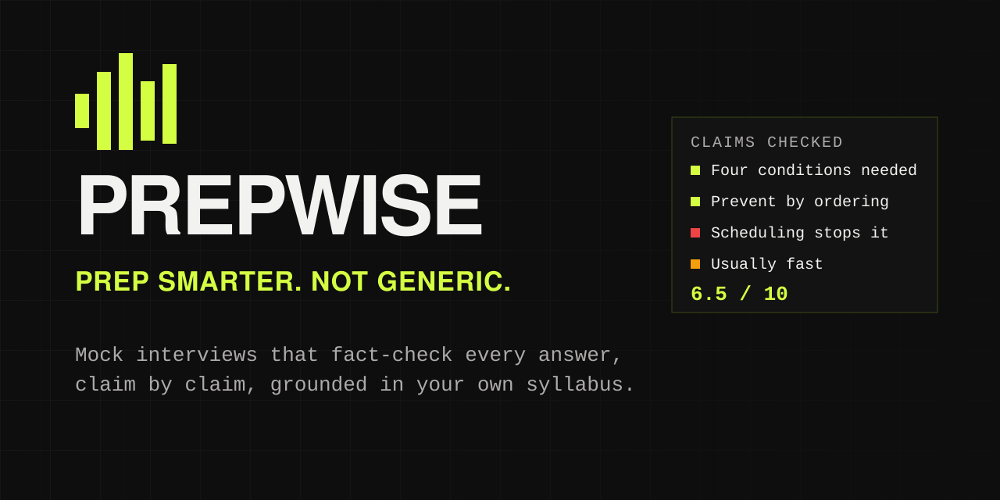
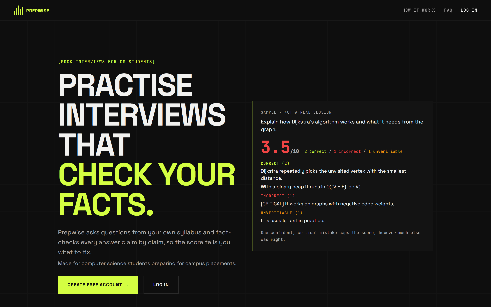
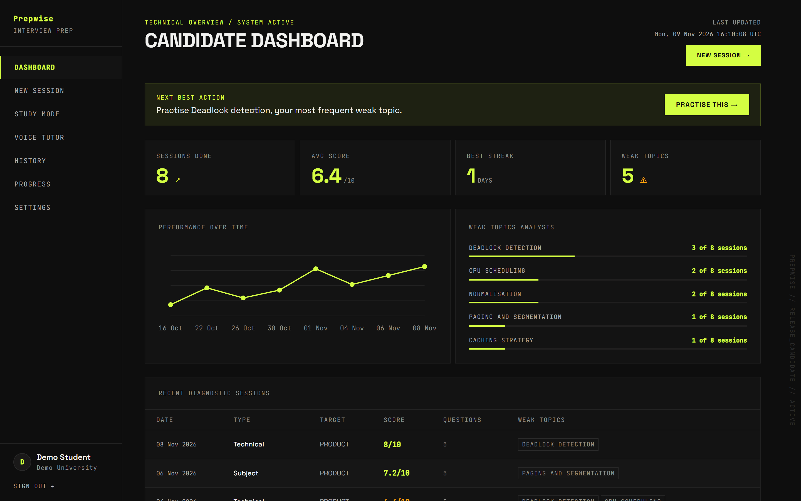
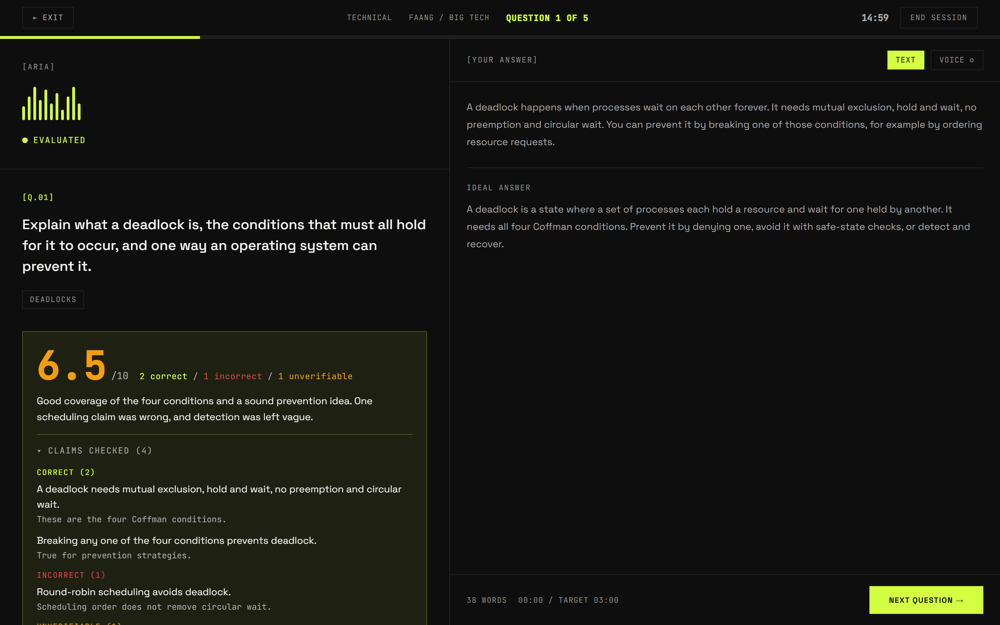
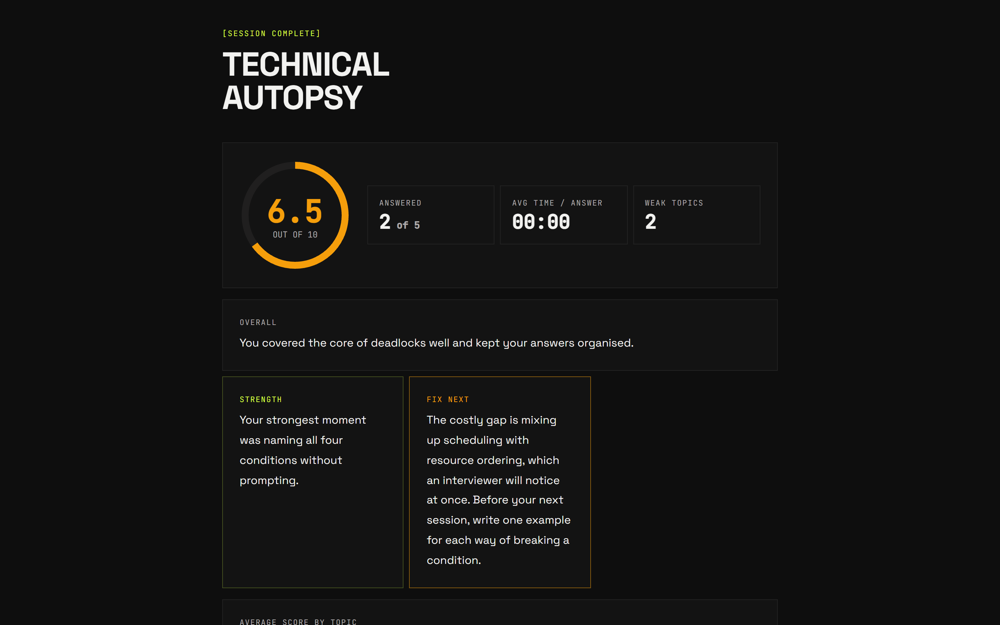
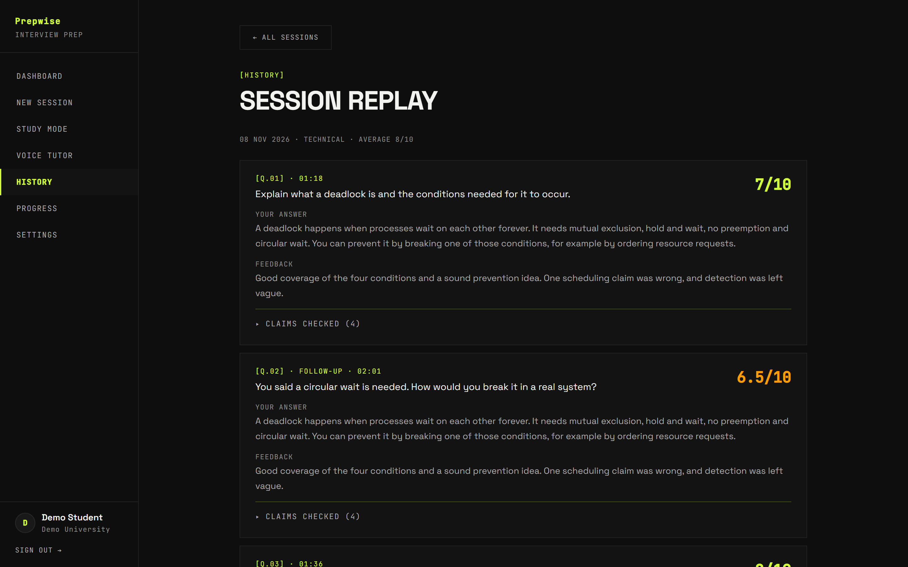
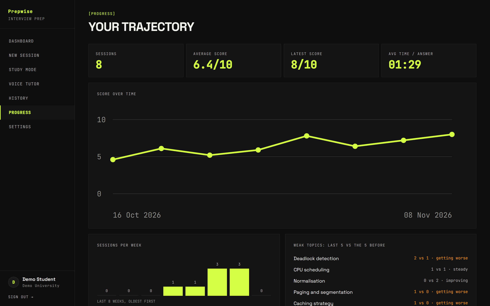
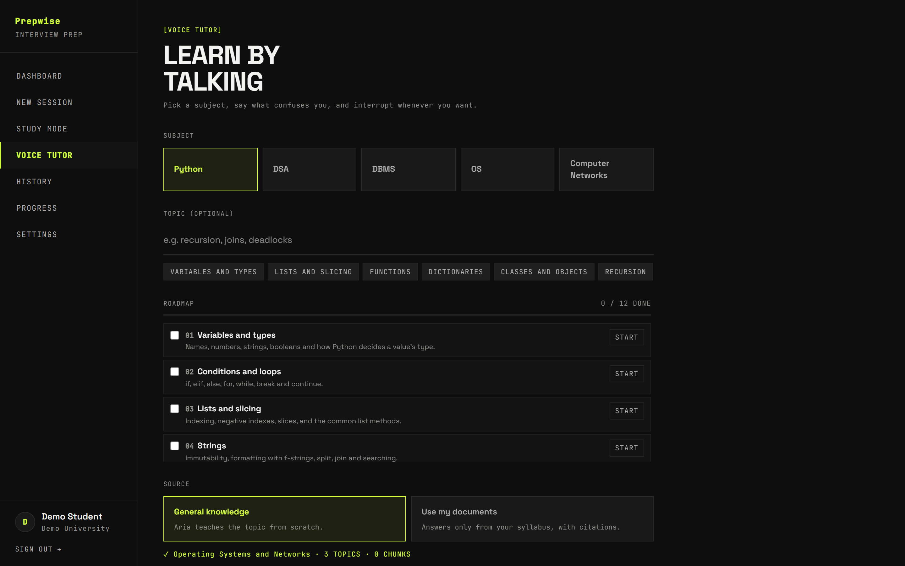
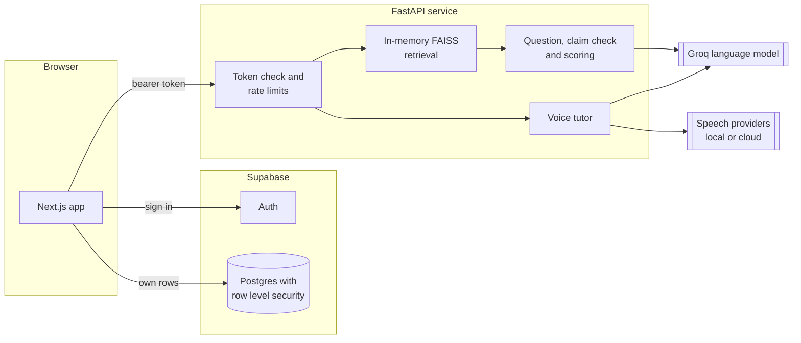

<div align="center">



<br />

[](LICENSE)
[](https://github.com/SuyashVJain/prepwise/actions/workflows/ci.yml)
[](https://github.com/SuyashVJain/prepwise/commits/main)
[](https://nextjs.org)
[](https://fastapi.tiangolo.com)
[](https://www.python.org)
[](https://supabase.com)

</div>

Prepwise is a mock-interview coach for computer science students. It generates questions from your own syllabus, then the language model checks every claim in your answer, so the score tells you what was right, what was wrong and what was too vague to count. It was built as a semester project and runs as a Next.js web app on top of a FastAPI service.

## Why it is different

- **Every answer is fact-checked.** Each claim in your answer is marked correct, incorrect or unverifiable before it is scored, and you can open the list after every question. A confident, critical mistake caps the score in code, however fluent the rest sounds. The check is made by the language model using its own knowledge; the syllabus is context for question generation, not the source of truth for correctness, and scores are a guide rather than a verdict.
- **Adaptive follow-ups.** If an answer is weak or has a doubtful claim, the next question can probe that exact point once, then move on.
- **Questions from your syllabus.** Upload a syllabus PDF or choose topics, and questions are generated using retrieved sections of that material as context instead of a fixed question bank. When you choose topics instead of uploading a PDF, the context is a short description of each topic rather than your own text.
- **A voice tutor.** Learn a subject by talking to Aria. Interrupt at any time, ask for a re-explanation, switch to Hinglish, and get notes and flashcards at the end.
- **Replay and progress.** Open any past session to see each question, answer, score and claim. Track scores, pace and weak topics over time.

## Screenshots

| | |
|---|---|
|  |  |
| **Landing page** | **Dashboard** |
|  |  |
| **Interview with checked claims** | **Debrief** |
|  |  |
| **Session replay** | **Progress** |

<details>
<summary>Voice tutor</summary>



</details>

The screenshots use made-up demo data. See [`scripts/screenshots`](scripts/screenshots) to regenerate them.

## Features

**Interview**
- Four interview types (technical, HR, system design, subject) and four company styles
- Questions generated from your syllabus, one at a time, with retrieved sections as context
- Type or speak your answers; a timer shows your pace against a soft target
- Adaptive follow-up questions, at most one per question and a third of a session
- Ending early saves only what you answered; a session in progress survives a page refresh

**Feedback**
- Claim-by-claim check with confidence and critical errors, shown as a collapsible list
- Score with fixed bands (8 to 9 for correct and complete, under 4 for a wrong core idea) and caps in code
- Debrief with score ring, strengths and fix-next cards, a topic chart, practice links and PDF export

**Study**
- Upload several documents and chat across them with source citations
- Generate multiple-choice quizzes from your material

**Voice tutor**
- Speech to text and text to speech run locally by default and fall back to cloud providers
- Doubt mode, Hinglish mode, session notes and flashcards, subject roadmaps, visual walkthroughs, video suggestions and a Python code-along
- Hand-off from the tutor to a mock interview on the same topic

**Progress and history**
- Filter and sort past sessions, replay any one, copy a summary
- Score trend, sessions per week and weak topic trend
- Settings with saved session defaults and a delete-my-data action

## Architecture



The web app signs in through Supabase and stores a student's sessions there under row level security. The API is stateless: it verifies the token, retrieves syllabus chunks, calls the language model and returns results. The full picture, including the answer-scoring pipeline and the reasons behind the main decisions, is in [docs/ARCHITECTURE.md](docs/ARCHITECTURE.md).

## Tech stack

| Layer | Technology |
|---|---|
| Frontend | Next.js 16, React, TypeScript, Tailwind CSS v4 |
| Backend | FastAPI, Python 3.11 |
| Language model | Groq, default `openai/gpt-oss-120b` |
| Retrieval | fastembed (ONNX) `all-MiniLM-L6-v2`, FAISS (in memory) |
| Documents | PyMuPDF, python-docx |
| Auth and data | Supabase Postgres with row level security |
| Voice | faster-whisper and Kokoro locally; Groq Whisper and edge-tts in the cloud |
| Deploy | Vercel (frontend), Render (backend) |

## Quick start

### Prerequisites

- Node.js 20 or newer and npm
- Python 3.11
- A [Supabase](https://supabase.com) project (free tier is fine)
- A [Groq](https://console.groq.com) API key

### 1. Clone

```bash
git clone https://github.com/SuyashVJain/prepwise.git
cd prepwise
```

### 2. Database

In the Supabase SQL editor, run the files in [`docs/migrations`](docs/migrations) in this order: `base_schema.sql`, `tutor_notes.sql`, `question_extras.sql`. Details are in [docs/DATABASE.md](docs/DATABASE.md).

### 3. Backend

macOS and Linux:

```bash
cd backend
python3.11 -m venv venv
source venv/bin/activate
pip install -r requirements.txt
cp .env.example .env        # then fill in the values
uvicorn app.main:app --reload --port 8000
```

Windows (PowerShell):

```powershell
cd backend
py -3.11 -m venv venv
venv\Scripts\Activate.ps1
pip install -r requirements.txt
copy .env.example .env      # then fill in the values
uvicorn app.main:app --reload --port 8000
```

### 4. Frontend

```bash
cd frontend
npm install
cp .env.example .env.local  # Windows: copy .env.example .env.local
npm run dev
```

Open <http://localhost:3000>, sign up, and finish onboarding.

### Environment variables

Backend (`backend/.env`):

| Name | Purpose | Required |
|---|---|---|
| `GROQ_API_KEY` | Language model key | Yes |
| `SUPABASE_URL` | Project URL, used to verify sign-in tokens | Yes |
| `SUPABASE_JWT_SECRET` | Only for projects on the legacy shared secret | No |
| `FRONTEND_URL` | Allowed browser origins, comma separated | No (defaults to localhost) |
| `LLM_MODEL`, `LLM_REASONING_EFFORT` | Model and reasoning effort | No |
| `RATE_LIMIT_LLM`, `RATE_LIMIT_UPLOAD`, `RATE_LIMIT_DEFAULT`, `RATE_LIMIT_TUTOR` | Per-user limits such as `30/minute` | No |
| `VOICE_WARMUP`, `VOICE_STT_PROVIDER`, `VOICE_TTS_PROVIDER` | Voice settings; use `0`, `cloud`, `cloud` to skip local models | No |
| `YOUTUBE_API_KEY` | Enables video suggestions in the tutor | No |

Frontend (`frontend/.env.local`):

| Name | Purpose | Required |
|---|---|---|
| `NEXT_PUBLIC_API_URL` | Backend base URL | Yes |
| `NEXT_PUBLIC_SUPABASE_URL` | Supabase project URL | Yes |
| `NEXT_PUBLIC_SUPABASE_ANON_KEY` | Supabase anon (publishable) key | Yes |
| `NEXT_PUBLIC_ENABLE_GOOGLE_AUTH` | `true` shows Google sign-in once the provider is enabled | No |
| `NEXT_PUBLIC_SITE_URL` | Public site address, for link previews and the sitemap | No |

### Run the tests

The backend tests need no keys or network. With the backend virtual environment active:

```bash
cd backend
python -m unittest discover -s tests -t .
python -m tests.score_comparison --offline
cd ../frontend
npm run lint
npx tsc --noEmit
npm run build
```

From the repository root, `npm test`, `npm run lint`, `npm run typecheck` and `npm run build` run the same checks.

### Optional: local voice models

The voice tutor falls back to cloud speech when the local models are not installed. To run speech models on your own machine:

```bash
cd backend
pip install -r requirements-voice.txt
```

See [docs/VOICE_TUTOR.md](docs/VOICE_TUTOR.md) for providers, Windows notes and limits.

## Project structure

```text
prepwise/
├── backend/            FastAPI service
│   ├── app/            routers, services (retrieval, scoring, follow-ups) and the voice tutor
│   ├── tests/          offline unit tests and the scoring comparison
│   └── scripts/        command-line helpers for the voice tutor
├── frontend/           Next.js app
│   ├── app/            pages and routes
│   ├── components/     shared interface components
│   ├── lib/            API client, Supabase clients, helpers
│   └── data/           curated tutor content
├── docs/               architecture, API, database, deploy, voice tutor, roadmap
│   ├── assets/         banner and screenshots
│   └── migrations/     SQL to run in Supabase
├── scripts/            tools that belong to neither app (screenshot generator)
└── .github/            CI workflow, issue and pull request templates
```

## Roadmap

Done: the interview loop with claim checking and follow-ups, history and progress, the voice tutor, study mode, account tools and CI. Next: job description and resume grounding, gap detection, a deadline-driven prep plan and spaced re-testing. The full list is in [docs/ROADMAP.md](docs/ROADMAP.md).

## Contributing

Issues and pull requests are welcome. Read [CONTRIBUTING.md](CONTRIBUTING.md) first, and report security problems privately as described in [SECURITY.md](SECURITY.md).

## License

MIT. See [LICENSE](LICENSE).

## Acknowledgements

Thanks to the School of Computer Science and Information Technology for the project course. Prepwise builds on Next.js, FastAPI, Supabase, FAISS, sentence-transformers, faster-whisper, Kokoro, Groq and many other open-source projects.
