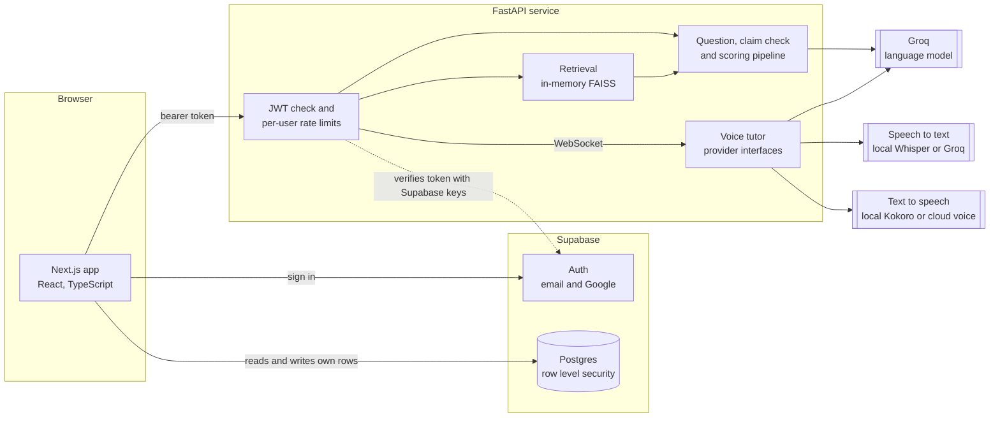
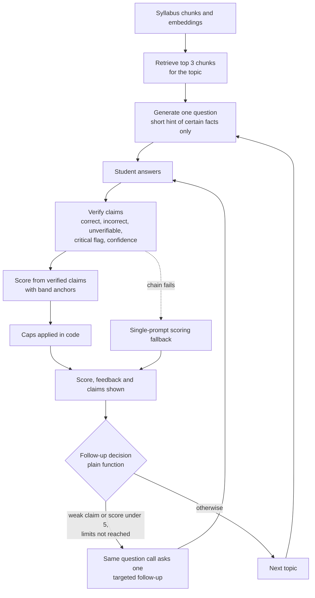

# Architecture

Prepwise has three parts: a Next.js web app, a stateless FastAPI service that does the heavy work, and Supabase for sign-in and storage. The web app talks to Supabase directly for the student's own data and to the API for anything that needs a language model, retrieval or speech.

## System overview

- **Browser.** Next.js App Router. It signs in through Supabase, stores sessions and answers in Supabase under row level security, and sends syllabus text and answers to the API with the student's access token.
- **API.** Stateless. It verifies the token on every route, applies per-user rate limits, builds a retrieval index from the syllabus the browser sends, and calls the language model. It does not store student data.
- **Supabase.** Auth and Postgres. Every table is protected by row level security, so a student can only read and change their own rows. See [DATABASE.md](DATABASE.md).

## Answer pipeline

1. **Retrieve.** The student's syllabus is split into chunks and embedded once. For each question the top three chunks for the chosen topic are retrieved and given to the model as context.
2. **Generate a question.** One model call. The question comes with keywords and a short hint that lists only facts the model is certain about.
3. **Verify claims.** A separate call lists each factual claim in the answer and marks it correct, incorrect or unverifiable. Each claim also carries a critical flag and a confidence of high or low. The question's hint is shown to this step only as a rough guide, and a claim that merely disagrees with it is marked unverifiable unless the checker is sure it is wrong.
4. **Score.** A second call produces the score, feedback and weak areas from the verified claims, using fixed score bands as anchors.
5. **Caps in code.** Whatever the model returns, the score is limited: no correct claims gives at most 2, more incorrect than correct claims at most 4, equal counts at most 5.5, and a critical incorrect claim with high confidence at most 4.
6. **Follow-up decision.** A plain function decides whether the next question should probe the weakest claim: only when there is a doubtful or wrong claim or the score is under 5, never twice in a row, and never more than a third of the session.
7. **Fallback.** If either model call fails or returns unusable output, the answer is scored with a single prompt so the session never breaks.

## Design decisions

- **Why FAISS in memory.** A student's syllabus is a few dozen to a few hundred chunks, used by one person at a time. An in-memory index built from vectors stored with the syllabus is exact, fast and needs no extra service. A vector database only pays for itself if retrieval ever has to span users or sessions.
- **Why check claims one by one.** A single "score this answer" prompt rewards fluent, confident writing. Listing and judging the claims first makes the score depend on what is actually true, and it gives the student something specific to fix. The claim list is shown in the app.
- **Why the caps live in code.** Prompts are suggestions, code is a guarantee. The caps keep a confidently wrong answer from scoring well even if the model is generous, and they are covered by offline tests.
- **Why only confident critical errors cap.** The question hint can be wrong. A cap needs a high-confidence verdict so that one wrong guess by the checker cannot sink a correct answer.
- **Why the backend is stateless.** The browser already holds the student's data through Supabase. Keeping the API free of storage makes it cheap to host and easy to scale or restart.
- **Why voice uses provider interfaces.** Speech to text, the language model and text to speech each sit behind a small interface. Local models are the default for privacy and cost on a laptop; if one is missing or fails, a cloud provider takes over and the page shows which one is active. See [VOICE_TUTOR.md](VOICE_TUTOR.md).

## Stack

| Layer | Technology |
|---|---|
| Frontend | Next.js 16, React, TypeScript, Tailwind CSS v4 |
| Backend | FastAPI, Python 3.11 |
| Language model | Groq, default model `openai/gpt-oss-120b` (set with `LLM_MODEL`) |
| Embeddings and search | sentence-transformers `all-MiniLM-L6-v2`, FAISS |
| Documents | PyMuPDF, python-docx |
| Auth and data | Supabase (Postgres, row level security) |
| Voice | faster-whisper and Kokoro locally; Groq Whisper and edge-tts in the cloud |
| Deploy | Vercel (frontend), Railway (backend) |
